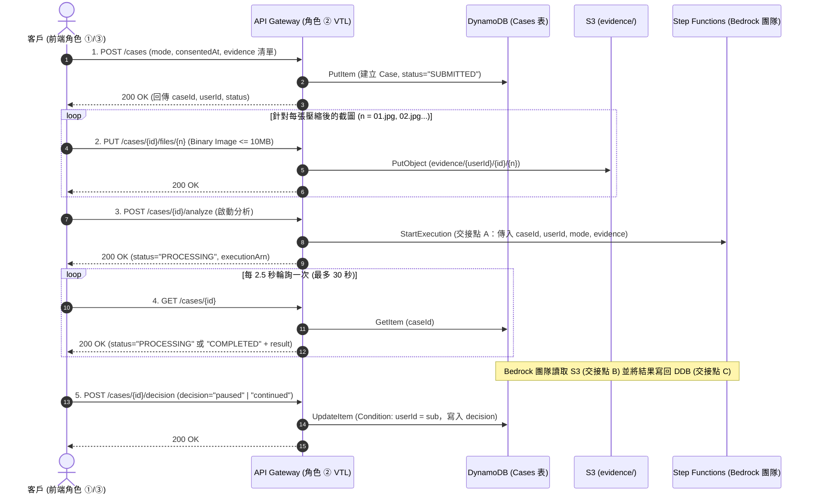

# AI 防詐安全守門員 — 後端 API 規格書與 AWS API Gateway 設定教學 (API-SPEC)

## 目錄

- [1. 架構決策與角色分工邊界](#1-架構決策與角色分工邊界)
- [2. 全域 API 規範與資安防線](#2-全域-api-規範與資安防線)
- [3. 資料儲存規格（DynamoDB Cases 表與 S3 Evidence）](#3-資料儲存規格dynamodb-cases-表與-s3-evidence)
- [4. 5 支 API 端點詳細規格與 VTL Mapping Templates](#4-5-支-api-端點詳細規格與-vtl-mapping-templates)
  - [4.1 API 1：建立案件 `POST /cases`](#41-api-1建立案件-post-cases)
  - [4.2 API 2：上傳截圖 `PUT /cases/{id}/files/{n}`](#42-api-2上傳截圖-put-casesidfilesn)
  - [4.3 API 3：啟動 AI 研判 `POST /cases/{id}/analyze`（交接點 A）](#43-api-3啟動-ai-研判-post-casesidanalyze交接點-a)
  - [4.4 API 4：取回研判結果 `GET /cases/{id}`（讀取交接點 C）](#44-api-4取回研判結果-get-casesid讀取交接點-c)
  - [4.5 API 5：回報客戶決策 `POST /cases/{id}/decision`](#45-api-5回報客戶決策-post-casesiddecision)
- [5. AWS Console 手把手設定教學（Step-by-Step）](#5-aws-console-手把手設定教學step-by-step)
  - [Step 1：建立 DynamoDB `Cases` 資料表與 S3 `Evidence` Bucket](#step-1建立-dynamodb-cases-資料表與-s3-evidence-bucket)
  - [Step 2：建立 API Gateway 執行角色 (IAM Role)](#step-2建立-api-gateway-執行角色-iam-role)
  - [Step 3：建立 REST API 與設定 Cognito Authorizer](#step-3建立-rest-api-與設定-cognito-authorizer)
  - [Step 4：設定 Binary Media Types（讓 S3 截圖上傳不損壞）](#step-4設定-binary-media-types讓-s3-截圖上傳不損壞)
  - [Step 5：逐一設定 5 支 API 的 AWS Service Integration](#step-5逐一設定-5-支-api-的-aws-service-integration)
  - [Step 6：設定 CORS 與 Gateway Responses（讓 401/403/429 帶有 CORS Header）](#step-6設定-cors-與-gateway-responses讓-401403429-帶有-cors-header)
  - [Step 7：設定 Stage Variables 並部署至 `dev` / `demo`](#step-7設定-stage-variables-並部署至-dev--demo)
- [6. 與 Bedrock 團隊跨帳號／跨角色 IAM 最小權限設定](#6-與-bedrock-團隊跨帳號跨角色-iam-最小權限設定)
- [7. 前端串接層（角色 ③）對接說明](#7-前端串接層角色-③對接說明)

---

## 1. 架構決策與角色分工邊界

### 1.1 架構決策：採用方案 1（API Gateway 直接整合 AWS 服務，不寫 Lambda）

完全依照 [`docs/fraud-guardian-design.md`](./fraud-guardian-design.md) 設計原則，後端 **不撰寫任何 Lambda（不需維護 Java 或 Golang 運算容器）**，由 **Amazon API Gateway (REST API)** 透過 **AWS Service Integration** 與 **VTL (Apache Velocity Template Language) Mapping Templates** 直接操作後端服務：

1. `POST /cases` → 直接呼叫 **DynamoDB `PutItem`**
2. `PUT /cases/{id}/files/{n}` → 直接呼叫 **S3 `PutObject`**
3. `POST /cases/{id}/analyze` → 直接呼叫 **Step Functions `StartExecution`**（交接點 A）
4. `GET /cases/{id}` → 直接呼叫 **DynamoDB `GetItem`**（讀取交接點 C）
5. `POST /cases/{id}/decision` → 直接呼叫 **DynamoDB `UpdateItem`**

### 1.2 角色對應表（專案分工 ↔ `copilot_rules`）

| 專案角色 | 對應 `copilot_rules` Role | 主要套用規範 (`instructions/`) | 職責與交付物 |
|---|---|---|---|
| **角色 ②：API 設定與對接** | `Role_SA_PM_Engineer.md`<br>`Role_Security_Engineer.md` | `A01_securityOwasp.md` | 制定本份 `docs/API-SPEC.md`、撰寫與測試 VTL Mapping Templates、提供 [`docs/openapi-apigw.yaml`](./openapi-apigw.yaml) 匯入檔、與 Bedrock 團隊定案交接點 A/B/C |
| **角色 ③：前端 API 串接** | `Role_React_Frontend.md` | `E02_reactFrontend.md`<br>`A01_securityOwasp.md` | 實作 Cognito Token 注入、Canvas 截圖壓縮（`<= 10 MB`）、替換 `frontend/src/features/evidence/api/useSubmitEvidence.ts`、`frontend/src/features/analysis/api/` 下的 `useAnalysisView.ts`、`useReportDecision.ts` |

---

## 2. 全域 API 規範與資安防線

依 `Role_Security_Engineer.md` 與 `A01_securityOwasp.md` 規定，所有 API 端點強制實施以下控制：

### 2.1 通訊與認證（Authentication & Authorization）

- **Endpoint 格式**：`https://{api-id}.execute-api.{region}.amazonaws.com/{stage}`（例如 `https://abc123xyz.execute-api.ap-northeast-1.amazonaws.com/dev`）。
- **認證機制**：全部 5 支 API（不含預檢 `OPTIONS`）皆掛載 **API Gateway Cognito User Pool Authorizer**。
  - 前端每次請求必須在 HTTP Header 帶入：`Authorization: Bearer <Cognito_ID_Token>`。
- **防止越權存取（IDOR 防護）**：
  - 使用者識別碼 `userId` **一律由 API Gateway VTL 從 Cognito Token Claims 提取**：`$context.authorizer.claims.sub`。
  - **嚴禁信任前端傳入的 `userId`**。
  - 上傳截圖（S3 Key 自動嵌入 `$context.authorizer.claims.sub`）、查詢結果（Response VTL 比對 `$item.userId.S == $context.authorizer.claims.sub`）與回報決策（DynamoDB `ConditionExpression: "userId = :uid"`）皆強制綁定本人身分。

### 2.2 輸入驗證與大小限制（對齊 `frontend/src/config/limits.ts`）

| 項目 | 上限／規則 | 防護層級 |
|---|---|---|
| 單筆截圖檔案大小 | `<= 10 MB`（前端先壓縮，超過會被 API Gateway 硬性拒絕） | 前端 Canvas 壓縮 + API Gateway 10 MB Payload 上限 |
| 允許的圖片 MIME 類型 | `image/png`、`image/jpeg`、`image/webp` | API Gateway Binary Media Types |
| 單案證據總筆數 (`MAX_EVIDENCE_ITEMS`) | `1 ~ 10` 筆（截圖＋網址＋文字合計） | 前端 `rules.ts` + API Request Model 驗證 |
| 單筆文字摘要長度 (`MAX_TEXT_LENGTH`) | `1 ~ 1000` 字元 | 前端 `rules.ts` + API Request Model 驗證 |
| 輸出防 XSS | AI 回傳之 `fraudType`、`signals`、`suggestion` 在前端一律以純文字渲染，禁止 `innerHTML` / `dangerouslySetInnerHTML` | 前端 React JSX 原生跳脫 |

### 2.3 統一錯誤回應格式與狀態碼

```json
{
  "error": {
    "code": "RATE_LIMITED",
    "message": "請求過於頻繁，請稍後再試"
  }
}
```

| HTTP 狀態碼 | 錯誤代碼 (`error.code`) | 觸發原因 | 前端（角色 ③）處理行為 |
|---|---|---|---|
| `400 Bad Request` | `INVALID_PAYLOAD` | JSON 格式錯誤、缺少必填欄位或違反 Request Schema | 視為請求失敗，轉換為 `{ phase: 'failed' }` |
| `401 Unauthorized` | `UNAUTHORIZED` | Cognito Token 缺失或過期 | 自動嘗試更新 Token；失敗則導回 `/login` |
| `403 Forbidden` | `FORBIDDEN` | 被 AWS WAF 阻擋，或嘗試存取非本人之 `caseId` | 轉換為 `AnalysisView` 的 `{ phase: 'blocked' }` |
| `404 Not Found` | `CASE_NOT_FOUND` | 指定的 `caseId` 不存在 | 轉換為 `{ phase: 'failed' }` 並顯示 165 備援管道 |
| `413 Payload Too Large` | `FILE_TOO_LARGE` | 單張截圖超過 API Gateway 10 MB 上限 | 前端壓縮確保小於 10 MB |
| `429 Too Many Requests` | `RATE_LIMITED` | 觸發 API Gateway / WAF Rate Limit | 轉換為 `{ phase: 'analyzing', retrying: true }`，延遲後自動重試 |
| `500 / 504` | `INTERNAL_ERROR` | AWS 服務呼叫失敗或逾時 | 輪詢期間可重試，超過總逾時（30 秒）轉為 `{ phase: 'failed' }` |

---

## 3. 資料儲存規格（DynamoDB Cases 表與 S3 Evidence）

### 3.1 DynamoDB 資料表設計：`Cases`

- **Table Name**：`ai-fraud-guardian-cases-${stageVariables.env}`（例如 `ai-fraud-guardian-cases-dev`）
- **Partition Key (PK)**：`caseId` (`String`，由 API Gateway VTL 以 `"c-$context.requestId"` 自動產生)
- **TTL (Time-to-Live) 欄位**：`expiresAt` (`Number`，選填，設定建立後 30 天自動刪除)

#### 資料表欄位清單（Attributes）

| 欄位名稱 | DynamoDB 型別 | 必填 | 寫入者 | 說明 |
|---|---|---|---|---|
| `caseId` | `S` (String) | 是 | 我方 (`POST /cases`) | 案件唯一識別碼（Partition Key，格式 `c-{requestId}`） |
| `userId` | `S` (String) | 是 | 我方 (`POST /cases`) | Cognito User `sub`（防越權檢查依據） |
| `mode` | `S` (String) | 是 | 我方 (`POST /cases`) | `"passive"`（被動查證）或 `"active"`（主動提醒） |
| `status` | `S` (String) | 是 | 雙方 | `"SUBMITTED"` → `"PROCESSING"` → `"COMPLETED"` / `"FAILED"` |
| `consentedAt` | `S` (String) | 是 | 我方 (`POST /cases`) | 客戶勾選同意之 ISO 8601 時間戳記 |
| `submittedAt` | `S` (String) | 是 | 我方 (`POST /cases`) | 案件建立時間 |
| `evidence` | `L` (List of Map) | 是 | 我方 (`POST /cases`) | 客戶提交的證據清單（含圖片 `s3Key`、`url`、`text`） |
| `result` | `M` (Map) | 否 | Bedrock 團隊（交接點 C） | AI 研判結果（`schemaVersion`, `riskLevel`, `fraudType`, `signals`, `suggestion`, `errorCode`） |
| `decision` | `S` (String) | 否 | 我方 (`POST /cases/{id}/decision`) | 客戶最終決策：`"paused"` 或 `"continued"` |
| `decidedAt` | `S` (String) | 否 | 我方 (`POST /cases/{id}/decision`) | 客戶按下決策按鈕時間 |

### 3.2 S3 Bucket 儲存規格：`Evidence`

- **Bucket Name**：由 Stage Variable `${stageVariables.evidenceBucket}` 指定（例如 `ai-fraud-guardian-evidence-dev`）
- **Object Key 命名規則**：
  ```text
  evidence/{userId}/{caseId}/{n}
  ```
  - `{userId}`：Cognito `sub`（由 API Gateway 直接從 `$context.authorizer.claims.sub` 注入）
  - `{caseId}`：`POST /cases` 回傳的 `caseId`
  - `{n}`：檔名與副檔名，固定格式如 `01.png`、`02.jpg`（由前端依序編碼為 `01.jpg` / `01.png`）
  - **範例**：`evidence/a1b2c3d4-e5f6/c-7f3a9d/01.jpg`
- **Lifecycle 規則**：設定 S3 Lifecycle Rule，對 Prefix `evidence/` 下的物件於建立 **30 天後自動刪除（Expiration: 30 days）**。

---

## 4. 5 支 API 端點詳細規格與 VTL Mapping Templates

### 呼叫時序圖（Sequence Diagram）



---

### 4.1 API 1：建立案件 `POST /cases`

- **AWS 服務整合設定**：
  - **AWS Service**：`DynamoDB`
  - **HTTP Method**：`POST`
  - **Action Name**：`PutItem`

#### Request Body (`application/json`)

```json
{
  "mode": "passive",
  "consentedAt": "2026-11-09T16:00:00.000Z",
  "evidence": [
    { "type": "image", "fileName": "01.jpg" },
    { "type": "url", "value": "https://reurl.cc/abc123" },
    { "type": "text", "value": "對方自稱投資顧問，保證每月穩賺 10%" }
  ]
}
```

#### Integration Request VTL (`application/json`)

```vtl
#set($caseId = "c-$context.requestId")
#set($userId = $context.authorizer.claims.sub)
#if(!$userId || $userId == "")
  #set($userId = "anonymous-dev")
#end
#set($inputRoot = $input.path('$'))
{
  "TableName": "ai-fraud-guardian-cases-${stageVariables.env}",
  "Item": {
    "caseId": { "S": "$caseId" },
    "userId": { "S": "$userId" },
    "mode": { "S": "$util.escapeJavaScript($inputRoot.mode)" },
    "status": { "S": "SUBMITTED" },
    "consentedAt": { "S": "$util.escapeJavaScript($inputRoot.consentedAt)" },
    "submittedAt": { "S": "$context.requestTime" },
    "evidence": {
      "L": [
        #foreach($item in $inputRoot.evidence)
        {
          "M": {
            "type": { "S": "$util.escapeJavaScript($item.type)" }
            #if($item.type == "image")
            ,"s3Key": { "S": "evidence/$userId/$caseId/$util.escapeJavaScript($item.fileName)" }
            #else
            ,"value": { "S": "$util.escapeJavaScript($item.value)" }
            #end
          }
        }#if($foreach.hasNext),#end
        #end
      ]
    }
  }
}
```

#### Integration Response VTL (`200 OK`, `application/json`)

```vtl
#set($caseId = "c-$context.requestId")
#set($userId = $context.authorizer.claims.sub)
#if(!$userId || $userId == "")
  #set($userId = "anonymous-dev")
#end
{
  "caseId": "$caseId",
  "userId": "$userId",
  "status": "SUBMITTED",
  "submittedAt": "$context.requestTime"
}
```

#### Response Body 範例 (`200 OK`)

```json
{
  "caseId": "c-8f14e45f-ceea-467f-a8f1-4e45fceea67f",
  "userId": "a1b2c3d4-e5f6-7890-abcd-ef1234567890",
  "status": "SUBMITTED",
  "submittedAt": "09/Nov/2026:08:00:01 +0000"
}
```

---

### 4.2 API 2：上傳截圖 `PUT /cases/{id}/files/{n}`

- **AWS 服務整合設定**：
  - **AWS Service**：`Simple Storage Service (S3)`
  - **HTTP Method**：`PUT`
  - **Action Type**：`Use path override`
  - **Path override**：`${stageVariables.evidenceBucket}/evidence/{userId}/{caseId}/{n}`
  - **URL Path Parameters 映射**：
    - `userId` → Mapped from: `context.authorizer.claims.sub`
    - `caseId` → Mapped from: `method.request.path.id`
    - `n` → Mapped from: `method.request.path.n`
  - **HTTP Headers 映射**：
    - `Content-Type` → Mapped from: `method.request.header.Content-Type`
  - **Content Handling**：`Passthrough`（配合 API Gateway Binary Media Types 設定 `image/png`, `image/jpeg`, `image/webp`）

#### Integration Response VTL (`200 OK`, `application/json`)

```vtl
{
  "uploaded": true
}
```

---

### 4.3 API 3：啟動 AI 研判 `POST /cases/{id}/analyze`（交接點 A）

- **AWS 服務整合設定**：
  - **AWS Service**：`Step Functions`
  - **HTTP Method**：`POST`
  - **Action Name**：`StartExecution`

#### Request Body (`application/json`)

前端將組裝完成的 `mode`、`submittedAt`（ISO 8601）與 `evidence`（圖片已換成 `s3Key: "evidence/{userId}/{caseId}/{n}"`）傳入：

```json
{
  "mode": "passive",
  "submittedAt": "2026-11-09T16:00:05+08:00",
  "evidence": [
    { "type": "image", "s3Key": "evidence/a1b2c3d4/c-7f3a/01.jpg" },
    { "type": "url", "value": "reurl.cc/abc123" },
    { "type": "text", "value": "保證每月穩賺 10%" }
  ]
}
```

#### Integration Request VTL (`application/json`)

組裝出符合 [`docs/fraud-guardian-design.md` §6.1](./fraud-guardian-design.md) 的交接點 A JSON，並呼叫 Bedrock 團隊的狀態機：

```vtl
#set($caseId = $input.params('id'))
#set($userId = $context.authorizer.claims.sub)
#if(!$userId || $userId == "")
  #set($userId = "anonymous-dev")
#end
#set($inputRoot = $input.path('$'))
#set($sfnInput = "{""schemaVersion"":""1.0"",""caseId"":""$util.escapeJavaScript($caseId)"",""userId"":""$util.escapeJavaScript($userId)"",""mode"":""$util.escapeJavaScript($inputRoot.mode)"",""submittedAt"":""$util.escapeJavaScript($inputRoot.submittedAt)"",""evidence"":$input.json('$.evidence')}")
{
  "stateMachineArn": "${stageVariables.bedrockStateMachineArn}",
  "name": "$util.escapeJavaScript($caseId)-$context.requestId",
  "input": "$util.escapeJavaScript($sfnInput)"
}
```

#### Integration Response VTL (`200 OK`, `application/json`)

```vtl
#set($caseId = $input.params('id'))
{
  "caseId": "$util.escapeJavaScript($caseId)",
  "status": "PROCESSING",
  "executionArn": $input.json('$.executionArn')
}
```

---

### 4.4 API 4：取回研判結果 `GET /cases/{id}`（讀取交接點 C）

- **AWS 服務整合設定**：
  - **AWS Service**：`DynamoDB`
  - **HTTP Method**：`POST`（注意：DynamoDB API 底層一律使用 `POST`，即使前端對 API Gateway 發送的是 `GET`！）
  - **Action Name**：`GetItem`

#### Integration Request VTL (`application/json`)

```vtl
{
  "TableName": "ai-fraud-guardian-cases-${stageVariables.env}",
  "Key": {
    "caseId": {
      "S": "$util.escapeJavaScript($input.params('id'))"
    }
  },
  "ConsistentRead": true
}
```

#### Integration Response VTL (`200 OK`, `application/json`)

將 DynamoDB 原生型別結構 (`{"S": "..."}`) 轉換為前端 [`AnalysisResult`](../frontend/src/types/analysis.ts) 所需的乾淨 JSON，並檢查 `userId` 防止跨案件越權查詢：

```vtl
#set($item = $input.path('$.Item'))
#set($callerUserId = $context.authorizer.claims.sub)
#if(!$callerUserId || $callerUserId == "")
  #set($callerUserId = "anonymous-dev")
#end
#if($item == "" || !$item.caseId || $item.caseId.S == "")
  #set($context.responseOverride.status = 404)
  {
    "error": {
      "code": "CASE_NOT_FOUND",
      "message": "找不到對應的查證案件"
    }
  }
#elseif($item.userId.S != $callerUserId)
  #set($context.responseOverride.status = 403)
  {
    "error": {
      "code": "FORBIDDEN",
      "message": "無權限存取此查證案件"
    }
  }
#else
  {
    "caseId": "$util.escapeJavaScript($item.caseId.S)",
    "status": "$util.escapeJavaScript($item.status.S)"
    #if($item.result && $item.result.M)
    ,"result": {
      "schemaVersion": "$util.escapeJavaScript($item.result.M.schemaVersion.S)",
      "riskLevel": "$util.escapeJavaScript($item.result.M.riskLevel.S)",
      "fraudType": "$util.escapeJavaScript($item.result.M.fraudType.S)",
      "signals": [
        #foreach($sig in $item.result.M.signals.L)
          "$util.escapeJavaScript($sig.S)"#if($foreach.hasNext),#end
        #end
      ],
      "suggestion": "$util.escapeJavaScript($item.result.M.suggestion.S)",
      "errorCode": #if($item.result.M.errorCode && $item.result.M.errorCode.S && $item.result.M.errorCode.S != "")"$util.escapeJavaScript($item.result.M.errorCode.S)"#else null #end
    }
    #end
  }
#end
```

---

### 4.5 API 5：回報客戶決策 `POST /cases/{id}/decision`

- **AWS 服務整合設定**：
  - **AWS Service**：`DynamoDB`
  - **HTTP Method**：`POST`
  - **Action Name**：`UpdateItem`

#### Request Body (`application/json`)

```json
{
  "decision": "paused"
}
```

#### Integration Request VTL (`application/json`)

```vtl
#set($caseId = $input.params('id'))
#set($userId = $context.authorizer.claims.sub)
#if(!$userId || $userId == "")
  #set($userId = "anonymous-dev")
#end
#set($decision = $input.path('$.decision'))
{
  "TableName": "ai-fraud-guardian-cases-${stageVariables.env}",
  "Key": {
    "caseId": { "S": "$util.escapeJavaScript($caseId)" }
  },
  "ConditionExpression": "userId = :uid",
  "UpdateExpression": "SET decision = :dec, decidedAt = :now",
  "ExpressionAttributeValues": {
    ":uid": { "S": "$util.escapeJavaScript($userId)" },
    ":dec": { "S": "$util.escapeJavaScript($decision)" },
    ":now": { "S": "$context.requestTime" }
  }
}
```

#### Integration Response VTL (`200 OK`, `application/json`)

```vtl
#set($caseId = $input.params('id'))
{
  "caseId": "$util.escapeJavaScript($caseId)",
  "recorded": true
}
```

---

## 5. AWS Console 手把手設定教學（Step-by-Step）

> [!TIP]
> **快速匯入捷徑**：除了在 AWS Console 手動建立外，我也已經為你準備好可直接匯入的 [`docs/openapi-apigw.yaml`](./openapi-apigw.yaml)。你可以在 **API Gateway → Create API → REST API → Import API** 直接上傳該檔案，即可自動建好 5 支路由與所有 VTL Mapping Templates，再補填 IAM Role ARN 與 Authorizer 即可！

以下為完整的 AWS Console 逐步設定教學（適合與角色 ④ 一起核對環境）：

### Step 1：建立 DynamoDB `Cases` 資料表與 S3 `Evidence` Bucket

1. **DynamoDB**：
   - 進入 **DynamoDB → Tables → Create table**
   - **Table name**：`ai-fraud-guardian-cases-dev`
   - **Partition key**：輸入 `caseId`，型別選 `String`（不設定 Sort key）
   - 點擊 **Create table**。
   - （選配）進入資料表的 **Additional settings → Time to Live (TTL)**，啟用 TTL 並輸入欄位名稱 `expiresAt`。
2. **S3 Bucket**：
   - 進入 **S3 → Create bucket**
   - **Bucket name**：`ai-fraud-guardian-evidence-dev-<你的AWS帳號ID>`
   - 保持 **Block all public access** 為勾選（安全最佳實務，因為是透過 API Gateway IAM Role 讀寫，不需要公開 Bucket）。
   - 建立完成後，進入 **Management → Lifecycle rules → Create lifecycle rule**：
     - Rule name：`expire-evidence-30days`
     - Prefix：`evidence/`
     - 勾選 **Expire current versions of objects**，Days after object creation 填 `30`。

---

### Step 2：建立 API Gateway 執行角色 (IAM Role)

API Gateway 需要一個 IAM Role 才能代替前端去寫入 DynamoDB、上傳 S3 與啟動 Step Functions。

1. 進入 **IAM → Roles → Create role**。
2. **Trusted entity type** 選 `AWS service`，**Service or use case** 選 `API Gateway`，連按 Next 先建立角色，命名為 `APIGatewayFraudGuardianRole`。
3. 進入剛建好的 `APIGatewayFraudGuardianRole`，點選 **Add permissions → Create inline policy**，貼上以下 JSON（請將 `<REGION>`、`<OUR_ACCOUNT_ID>`、`<BEDROCK_ACCOUNT_ID>` 換成實際值）：

```json
{
  "Version": "2012-10-17",
  "Statement": [
    {
      "Sid": "DynamoDBCasesAccess",
      "Effect": "Allow",
      "Action": [
        "dynamodb:PutItem",
        "dynamodb:GetItem",
        "dynamodb:UpdateItem"
      ],
      "Resource": "arn:aws:dynamodb:<REGION>:<OUR_ACCOUNT_ID>:table/ai-fraud-guardian-cases-*"
    },
    {
      "Sid": "S3EvidencePutObject",
      "Effect": "Allow",
      "Action": [
        "s3:PutObject"
      ],
      "Resource": "arn:aws:s3:::ai-fraud-guardian-evidence-*/evidence/*"
    },
    {
      "Sid": "StepFunctionsStartAnalysis",
      "Effect": "Allow",
      "Action": [
        "states:StartExecution"
      ],
      "Resource": "arn:aws:states:<REGION>:<BEDROCK_ACCOUNT_ID>:stateMachine:*"
    }
  ]
}
```
4. 複製此角色的 **Role ARN**（如 `arn:aws:iam::123456789012:role/APIGatewayFraudGuardianRole`），Step 5 會用到。

---

### Step 3：建立 REST API 與設定 Cognito Authorizer

1. 進入 **API Gateway → Create API**，選擇 **REST API → Build**（**注意：一定要選 REST API，不能選 HTTP API**，因為只有 REST API 支援 VTL Mapping Templates 與 S3 直接整合）。
2. **API name** 填 `ai-fraud-guardian-api`，**Endpoint Type** 選 `Regional`。
3. 左側選單點 **Authorizers → Create authorizer**：
   - **Authorizer name**：`CognitoUserPoolAuthorizer`
   - **Authorizer type**：`Cognito`
   - **Cognito User Pool**：選擇角色 ④ 建立的 Cognito User Pool
   - **Token source**：輸入 `Authorization`
   - 點擊 **Create authorizer**。

---

### Step 4：設定 Binary Media Types（讓 S3 截圖上傳不損壞）

如果不設定這一步，API Gateway 會把上傳的 PNG/JPG 二進位圖片當成 UTF-8 字串處理而導致圖片損毀！

1. 在 API Gateway 左側選單點 **API Settings**。
2. 往下找到 **Binary media types** 區塊，點 **Manage binary media types**。
3. 依序新增以下三種型別並儲存：
   - `image/png`
   - `image/jpeg`
   - `image/webp`

---

### Step 5：逐一設定 5 支 API 的 AWS Service Integration

在左側選單 **Resources** 建立以下路徑階層：
```text
/
└── cases                       (POST)
    └── {id}                    (GET)
        ├── analyze             (POST)
        ├── decision            (POST)
        └── files
            └── {n}             (PUT)
```

每個 Method 的設定重點如下（每個 Method 的 **Method Request → Authorization** 都要選 `CognitoUserPoolAuthorizer`）：

1. **`POST /cases`**：
   - **Integration type**：`AWS Service`
   - **AWS Region**：選擇你的區域（如 `ap-northeast-1`）
   - **AWS Service**：`DynamoDB`
   - **HTTP method**：`POST`
   - **Action Type**：`Use action name` → **Action name** 填 `PutItem`
   - **Execution role**：貼上 Step 2 的 `APIGatewayFraudGuardianRole` ARN
   - 展開 **Mapping templates**，新增 `application/json`，貼上本文件 **4.1 節的 Integration Request VTL**。
   - 切到 **Integration Response**，展開 `200` 的 Mapping templates (`application/json`)，貼上 **4.1 節的 Integration Response VTL**。

2. **`PUT /cases/{id}/files/{n}`**：
   - 先在 **Method Request** 的 **HTTP Request Headers** 新增 `Content-Type`。
   - **Integration Request**：
     - **Integration type**：`AWS Service`
     - **AWS Service**：`Simple Storage Service (S3)`
     - **HTTP method**：`PUT`
     - **Action Type**：`Use path override`
     - **Path override**：`${stageVariables.evidenceBucket}/evidence/{userId}/{caseId}/{n}`
     - **Execution role**：貼上 `APIGatewayFraudGuardianRole` ARN
     - **Content Handling**：`Passthrough`
     - **URL Path Parameters**：
       - 新增 `userId`，Mapped from 填 `context.authorizer.claims.sub`
       - 新增 `caseId`，Mapped from 填 `method.request.path.id`
       - 新增 `n`，Mapped from 填 `method.request.path.n`
     - **HTTP Headers**：
       - 新增 `Content-Type`，Mapped from 填 `method.request.header.Content-Type`
   - **Integration Response**：Mapping template (`application/json`) 貼上 `{"uploaded": true}`。

3. **`POST /cases/{id}/analyze`**：
   - **Integration type**：`AWS Service`
   - **AWS Service**：`Step Functions`
   - **HTTP method**：`POST`
   - **Action Type**：`Use action name` → **Action name** 填 `StartExecution`
   - **Execution role**：貼上 `APIGatewayFraudGuardianRole` ARN
   - **Integration Request Mapping template** (`application/json`)：貼上 **4.3 節的 Request VTL**。
   - **Integration Response Mapping template** (`application/json`)：貼上 **4.3 節的 Response VTL**。

4. **`GET /cases/{id}`**：
   - **Integration type**：`AWS Service`
   - **AWS Service**：`DynamoDB`
   - **HTTP method**：`POST`（**極重要**：雖然對外是 `GET /cases/{id}`，但對 DynamoDB 的 Integration HTTP Method 必須選 `POST`！）
   - **Action Type**：`Use action name` → **Action name** 填 `GetItem`
   - **Execution role**：貼上 `APIGatewayFraudGuardianRole` ARN
   - **Integration Request Mapping template** (`application/json`)：貼上 **4.4 節的 Request VTL**。
   - **Integration Response Mapping template** (`application/json`)：貼上 **4.4 節的 Response VTL**。

5. **`POST /cases/{id}/decision`**：
   - **Integration type**：`AWS Service`
   - **AWS Service**：`DynamoDB`
   - **HTTP method**：`POST`
   - **Action Type**：`Use action name` → **Action name** 填 `UpdateItem`
   - **Execution role**：貼上 `APIGatewayFraudGuardianRole` ARN
   - **Integration Request Mapping template** (`application/json`)：貼上 **4.5 節的 Request VTL**。
   - **Integration Response Mapping template** (`application/json`)：貼上 **4.5 節的 Response VTL**。

---

### Step 6：設定 CORS 與 Gateway Responses（讓 401/403/429 帶有 CORS Header）

1. **為每個資源啟用 CORS**：
   - 在 `/cases`、`/cases/{id}`、`/cases/{id}/files/{n}`、`/cases/{id}/analyze`、`/cases/{id}/decision` 上分別點選 **Enable CORS**。
   - 勾選對應的 Method（如 `GET`, `POST`, `PUT`, `OPTIONS`），`Access-Control-Allow-Headers` 確認包含 `Content-Type,Authorization`，`Access-Control-Allow-Origin` 填入前端網址（本機開發期間可暫設 `*` 或 `http://localhost:5173`）。
2. **為每個 200 Method Response 加入 CORS Header**：
   - 確認 5 支 API 的 **Method Response (`200`)** 已宣告 `Access-Control-Allow-Origin` Header，且 **Integration Response (`200`)** 的 Header Mapping 將 `Access-Control-Allow-Origin` 設為 `'*'`（或前端網域）。
3. **Gateway Responses（重要防坑！）**：
   - 當 Cognito Authorizer 回傳 `401 Unauthorized` 或 WAF/Throttling 回傳 `403`/`429` 時，請求還沒進到你的 Integration Response，瀏覽器如果沒看到 CORS Header 會直接報 `CORS Error` 導致前端拿不到 `401`/`403`/`429` 狀態碼！
   - 解法：點選左側選單 **Gateway Responses**，針對 **`Default 4XX`** 與 **`Default 5XX`** 點擊 **Edit**，在 Response headers 新增：
     - Header name：`Access-Control-Allow-Origin`，Value：`'*'`
     - Header name：`Access-Control-Allow-Headers`，Value：`'Content-Type,Authorization'`

---

### Step 7：設定 Stage Variables 並部署至 `dev` / `demo`

1. 點選右上角 **Deploy API**，建立新 Stage `dev`。
2. 進入左側 **Stages → dev → Stage variables**，新增以下 3 個變數：
   | Name | Value 範例 | 用途 |
   |---|---|---|
   | `env` | `dev` | 組合 DynamoDB 表名 `ai-fraud-guardian-cases-dev` |
   | `evidenceBucket` | `ai-fraud-guardian-evidence-dev-123456789012` | S3 Bucket 名稱 |
   | `bedrockStateMachineArn` | `arn:aws:states:ap-northeast-1:999999999999:stateMachine:FraudGuardianMock` | Bedrock 團隊提供的 Step Functions ARN |
3. 複製 Stage 頁面頂部的 **Invoke URL**（例如 `https://xyz.execute-api.ap-northeast-1.amazonaws.com/dev`），填入前端 `frontend/.env.local` 的 `VITE_API_BASE_URL` 即可開始測試！
4. **（選配）在 Bedrock 團隊完成前先自己測通 5 支 API**：
   - 可至 AWS Console **Step Functions → State machines → Create state machine**，匯入本目錄下的 **[`docs/mock-state-machine.asl.json`](./mock-state-machine.asl.json)**（命名為 `FraudGuardianMock`）。
   - 該狀態機完全不需 Lambda，收到交接點 A 的 `caseId` 後會自動把 DynamoDB 狀態改為 `PROCESSING`、等待 3 秒後寫回 `COMPLETED` 與假投資詐騙分析結果（交接點 C），讓你能獨立驗證整條 AWS API Gateway 流程！

---

## 6. 與 Bedrock 團隊跨帳號／跨角色 IAM 最小權限設定

請將以下兩份權限交由角色 ④ 設定，讓 Bedrock 團隊（交接點 A/B/C）能跨團隊存取：

1. **Bedrock 團隊的 Step Functions Resource Policy（由 Bedrock 團隊設定，允許我方啟動交接點 A）**：
   允許我方 `arn:aws:iam::<OUR_ACCOUNT_ID>:role/APIGatewayFraudGuardianRole` 呼叫 `states:StartExecution`。
2. **我方 S3 Bucket Policy（交接點 B：允許 Bedrock 團隊唯讀 `evidence/*`）**：
   ```json
   {
     "Version": "2012-10-17",
     "Statement": [
       {
         "Sid": "AllowBedrockTeamReadEvidenceOnly",
         "Effect": "Allow",
         "Principal": {
           "AWS": "arn:aws:iam::<BEDROCK_ACCOUNT_ID>:role/<BEDROCK_EXECUTION_ROLE>"
         },
         "Action": ["s3:GetObject"],
         "Resource": "arn:aws:s3:::ai-fraud-guardian-evidence-*/evidence/*"
       }
     ]
   }
   ```
3. **我方提供給 Bedrock 團隊的 DynamoDB 寫回權限（交接點 C：僅允許更新 `status` 與 `result`）**：
   若同帳號，直接附加於對方 Role；若跨帳號，可建立一個 `BedrockCallbackWriteRole` 供對方 `sts:AssumeRole`：
   ```json
   {
     "Version": "2012-10-17",
     "Statement": [
       {
         "Sid": "AllowBedrockTeamWriteResultOnly",
         "Effect": "Allow",
         "Action": ["dynamodb:UpdateItem"],
         "Resource": "arn:aws:dynamodb:<REGION>:<OUR_ACCOUNT_ID>:table/ai-fraud-guardian-cases-*",
         "Condition": {
           "ForAllValues:StringEquals": {
             "dynamodb:Attributes": ["caseId", "status", "result", "updatedAt"]
           }
         }
       }
     ]
   }
   ```

---

## 7. 前端串接層（角色 ③）對接說明

前端專案（`frontend/`）已針對本規格書完成串接層設計：

- **環境變數設定（`frontend/.env.example` / `frontend/.env.local`）**：
  - `VITE_API_BASE_URL`：API Gateway Stage Invoke URL（未設定或網址帶 `?mock=` 時，自動使用本地示範假資料，方便無後端時開發與 Demo 備援）。
  - `VITE_COGNITO_TOKEN`（選填）：本機測試 API Gateway 時可直接注入測試用 Cognito JWT；正式環境由登入流程寫入 `sessionStorage`。
- **串接檔案對應**：
  - [`frontend/src/lib/imageCompressor.ts`](../frontend/src/lib/imageCompressor.ts)：在瀏覽器端透過 Canvas 將截圖壓縮並限制於 `10 MB` 以內。
  - [`frontend/src/lib/guardianApi.ts`](../frontend/src/lib/guardianApi.ts)：封裝 5 支 API 的呼叫、Cognito Bearer Token Header 注入，以及 `401` / `403` / `429` 狀態碼解析。
  - [`frontend/src/features/evidence/api/useSubmitEvidence.ts`](../frontend/src/features/evidence/api/useSubmitEvidence.ts)、[`frontend/src/features/analysis/api/useAnalysisView.ts`](../frontend/src/features/analysis/api/useAnalysisView.ts)、[`frontend/src/features/analysis/api/useReportDecision.ts`](../frontend/src/features/analysis/api/useReportDecision.ts)：串接完整 5 步驟非同步流程與每 2.5 秒輪詢（30 秒逾時自動切換 165 備援畫面）。
